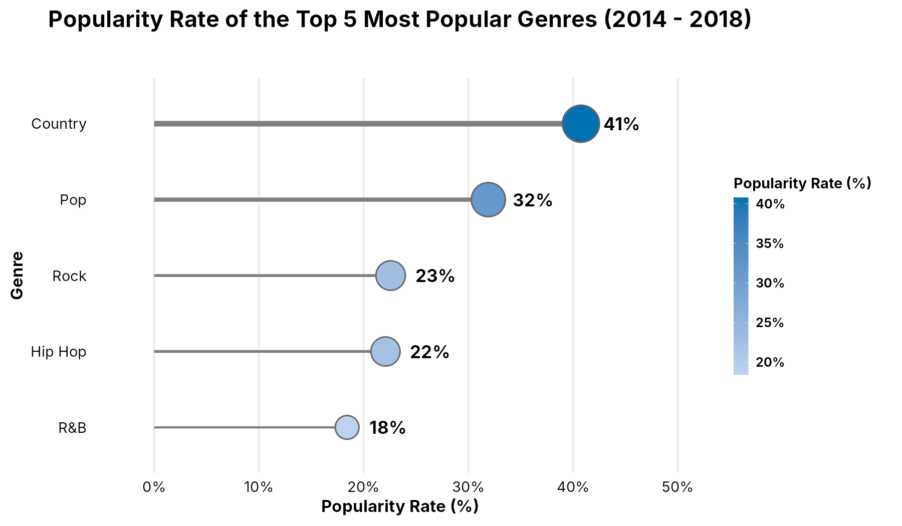
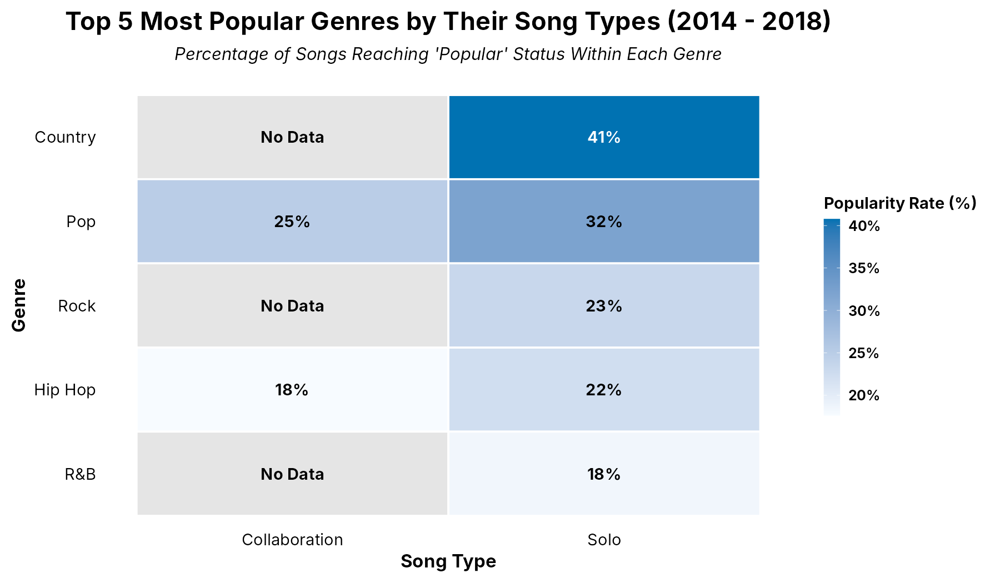
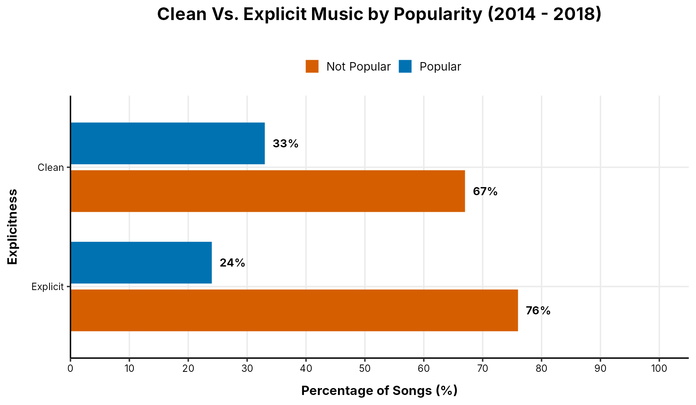
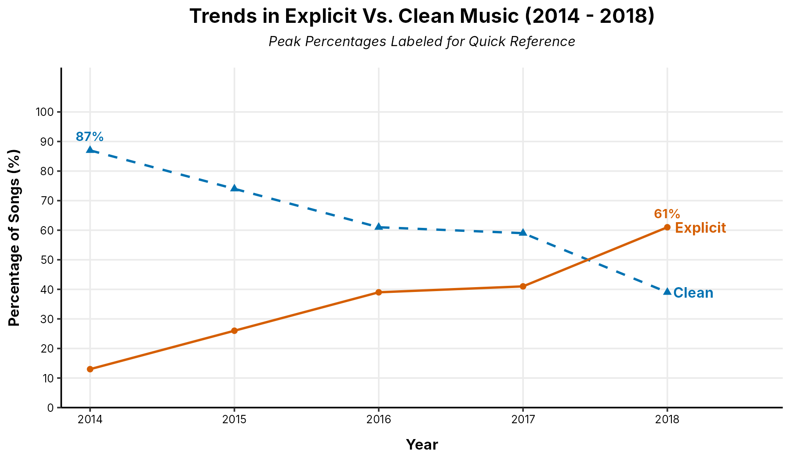
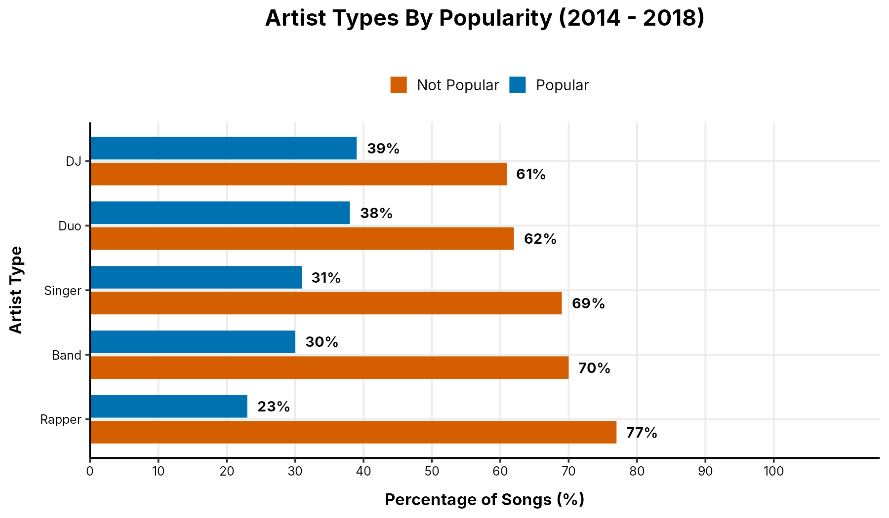
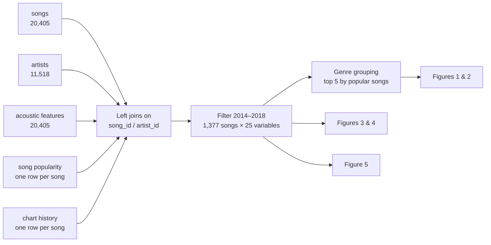

# Does Metadata Make a Hit? Song Popularity in the Streaming Era

**A data visualisation study in R and ggplot2 of how genre, explicitness, artist type and song type relate to song popularity, across 1,377 Billboard Hot 100 songs from 2014 to 2018.**


MSc Data Science, University of Sheffield (2026) · Module: IJC445 Data Visualisation · Author: **Cailey Coghlan**

📄 [Read the full report (PDF)](docs/report.pdf) · 💻 [View the R code](R/data_visualisation.R) · 📊 [See the figures](#the-composite-visualisation)

---

## Project summary

### The problem
In 2023, music labels invested a record $8.1 billion in finding and developing artists, yet roughly 80–90% of artists never achieve commercial success. Most research into what makes a hit focuses on **acoustic features** such as tempo, energy and danceability. Much less is known about whether a song's **metadata** explains its popularity.

This study uses data visualisation to examine the relationship between four metadata features (**genre, song explicitness, artist type and song type**) and song popularity in the streaming era.

### What I did
I used the **MusicOSet** dataset, which combines Billboard, Spotify and Genius data, and focused on Hot 100 songs from **2014 to 2018**, the most recent streaming-era years it covers. In **R**, I:

1. **Combined five tables into one dataset.** I cleaned the songs, artists, acoustic features, popularity and chart tables, then joined them on song and artist IDs. That gave 1,377 songs from 2014 to 2018 and 25 variables, with no duplicate songs.
2. **Grouped 120 detailed genres into broad families** (Pop, Hip Hop, Country, Rock, R&B and others), using text pattern matching on each artist's main genre.
3. **Designed five figures in ggplot2** around a single popularity measure: `is_pop`, MusicOSet's flag for whether a song reached the year-end charts. Each figure was built using the grammar of graphics, and designed to be accessible and to tell a clear story to a non-specialist audience.

### What I found
- **Genre shows the clearest pattern.** Country songs had the highest popularity rate, with 41% reaching popular status, compared with 32% for Pop and 18% for R&B. Even so, most songs in every genre were not popular.
- **Solo songs did better than collaborations** in the leading genres. For example, 32% of solo Pop songs were popular, against 25% of Pop collaborations.
- **Clean songs were more often popular than explicit ones** (33% vs 24%), even though explicit songs grew from 13% of charting songs in 2014 to 61% in 2018.
- **DJs had the highest popularity rate of any artist type (39%)** and rappers the lowest (23%).
- **Overall, metadata features look like weak predictors of popularity.** In every genre and artist type studied, most songs were not popular: between 59% and 82%, depending on the group.

### Why it matters
Ranked from most to least notable, the features are genre, artist type, song explicitness and song type. For labels deciding where to invest, the data points towards **country or DJ soloists with clean lyrics**. The small differences between groups also help explain why research has favoured acoustic features. Confirming these relationships would need statistical testing, which is a natural next step.

---

## The composite visualisation

### Figure 1. Popularity rate of the top 5 genres


The five genres with the most popular songs, ranked by the share of their songs that became popular. Country leads at 41%.

### Figure 2. Popularity rate by genre and song type


Within the leading genres, solo songs reach popular status more often than collaborations.

### Figure 3. Clean vs explicit songs by popularity


33% of clean songs were popular, compared with 24% of explicit songs.

### Figure 4. The rise of explicit music


Explicit songs rose from 13% of charting songs in 2014 to 61% in 2018. Read alongside Figure 3, this shows the shift towards explicit music didn't bring proportionately more popular songs.

### Figure 5. Artist type by popularity


DJs had the highest share of popular songs (39%) and rappers the lowest (23%).

*High-resolution PDFs of every figure are in [`figures/`](figures/), and the numbers behind each one are in [`results/`](results/).*

---

## Design decisions

| Principle | How the figures apply it |
|---|---|
| **Accurate perception** | Bars and lollipops encode values as length from a common zero baseline, which people judge more accurately than angles or areas (Cleveland & McGill, 1984). Grouped bars were chosen over segmented bars, pie charts and Cleveland dot plots for this reason. |
| **Colour-blind safe palette** | Every figure uses the Okabe-Ito palette: blue (`#0072B2`) and vermilion (`#D55E00`). The line chart also separates its series by line type (solid vs dashed) and marker shape, so it doesn't rely on colour alone. |
| **Readable in greyscale** | Figures 1 and 2 use shades of a single blue, so they still read correctly when printed in black and white, and for readers with total colour blindness. |
| **Low cognitive load** | Every value is labelled directly on the chart, so readers don't need to trace back to an axis or legend. Category labels sit on the y-axis so they read horizontally. |
| **Legibility** | The figures use high-contrast black text on white, a sans-serif font (the most legible for readers with dyslexia), and white space between tiles and bars to reduce crowding. |
| **Honest framing** | On its own, Figure 4 could suggest explicit songs are more popular, because it doesn't show popularity at all. Pairing it with Figure 3 shows that explicitness rose without bringing more popular songs. |

---

## Data preparation



- **Lead artist.** Each song is linked to its lead (first-credited) artist on Billboard, so that artist type and genre can be attached to it.
- **One row per song.** The popularity table keeps each song's first year in the year-end data, and the chart table keeps each song's best peak position and longest run on the chart. This prevents duplicate rows when the tables are joined.
- **Missing values.** Missing artist types (64 songs) and genres (35 songs) are excluded only from the figures that use them, which keeps as much data as possible.

The original MusicOSet files are in [`data/original/`](data/original/) and the cleaned versions used by the code are in [`data/cleaned/`](data/cleaned/). Every change between them is listed in the [file guide](docs/FILE_GUIDE.md#how-the-original-files-were-cleaned).

---

## Limitations and next steps

- **The analysis is descriptive.** The figures show patterns but don't test them, so no link between metadata and popularity can be confirmed. A logistic regression or chi-square tests would be the next step.
- **The scope is narrow.** MusicOSet only includes songs that reached the Billboard charts, it's mostly American, and it ends in 2018. Non-charting songs and other markets aren't represented.
- **Some groups are small.** DJs (18 songs), duos (40) and Pop collaborations (8) give percentages that could shift substantially with a few more songs.
- **Popularity is measured in a song's first year.** Each song is counted once, using the popularity label from its first year in the data. 97 songs became popular only in a later year, so they count as not popular here.
- **"No Data" covers two cases in Figure 2.** Country and R&B have no collaborations in the data. Rock has one, which wasn't popular, and the code labels 0% tiles as "No Data" too.
- **Next steps:**
  - Test the associations statistically.
  - Add a figure showing popularity for all solo vs collaborative songs.
  - Extend the data past 2018 and beyond the charts.
  - Explore lyrics, which research suggests are an under-explored driver of popularity.

---

## Repository structure

```
song-popularity-metadata-visualisation/
├── README.md                                   # this page
├── song-popularity-metadata-visualisation.Rproj # open this in RStudio
├── R/
│   └── data_visualisation.R                    # the full analysis: joins, cleaning checks, all five figures
├── data/
│   ├── original/                               # the five MusicOSet tables as downloaded
│   ├── cleaned/                                # the five cleaned tables the code reads
│   └── processed/
│       └── modern_music_dataset.csv            # the combined 2014–2018 dataset (created by the code)
├── figures/                                    # the five figures, as PNG and high-resolution PDF
├── results/                                    # the data behind each figure, as CSV
└── docs/
    ├── report.pdf                              # the full report
    └── FILE_GUIDE.md                           # what every file is, and how the data was cleaned
```

**Guide to every file:** [docs/FILE_GUIDE.md](docs/FILE_GUIDE.md)

---

## How to run

1. **Download the repository.** Click the green **Code** button, then **Download ZIP**, and unzip it.
2. **Install the packages** (first time only). In the R console, run:
   ```r
   install.packages(c("tidyverse", "scales"))
   ```
3. **Open the project.** Double-click `song-popularity-metadata-visualisation.Rproj`. This opens RStudio with the repository folder as the working directory, so every file path works.
4. **Run the code.** Open `R/data_visualisation.R` and click **Source**. It rebuilds the combined dataset, all five figures and the result tables.

The code was written in R with RStudio 2025.09.0+387, and it runs in a few seconds.

---

## Tech stack

**Language:** R · **Packages:** tidyverse (`dplyr`, `readr`, `tidyr`, `stringr`, `ggplot2`), `scales` · **Environment:** RStudio

**Skills shown:** joining relational tables · data cleaning and validation (duplicate and missing-value checks) · feature grouping with regular expressions · ggplot2 and the grammar of graphics (geoms, scales, coordinates, themes) · heat maps, lollipop charts, grouped bars and line charts · accessible design (colour-blind safe palettes, direct labelling, greyscale-safe gradients) · choosing chart types from perception research · spotting misleading framing · writing for a non-technical audience

---

## Data source

Silva, M. O., Rocha, L. M., & Moro, M. M. (2019). *MusicOSet: An enhanced open dataset for music data mining.* In XXXIV Simpósio Brasileiro de Banco de Dados: Dataset Showcase Workshop (SBBD 2019 Companion), pp. 408–417. [https://doi.org/10.5281/zenodo.4904639](https://doi.org/10.5281/zenodo.4904639) · Dataset site: [marianaossilva.github.io/DSW2019](https://marianaossilva.github.io/DSW2019/)

MusicOSet is published for research use. The tables used in this project are included here with credit to its authors.

---

## Contact

**Cailey Coghlan**, MSc Data Science, University of Sheffield
[LinkedIn](https://www.linkedin.com/in/cailey-coghlan-10a8a8173/) · [Email](mailto:caileycog@outlook.com)

**More projects:**
- [Psoriasis Biomarker Discovery](https://github.com/caileycog/psoriasis-biomarker-discovery): R, limma, nested CV, SHAP
- [Airline Passenger Satisfaction](https://github.com/caileycog/airline-passenger-satisfaction): KNIME, logistic regression vs gradient boosted trees
- [Big Data Analysis of ICLR Submissions](https://github.com/caileycog/iclr-submissions-big-data-analysis): PySpark, Databricks, Spark MLlib
- [Who Voted Leave?](https://github.com/caileycog/eu-referendum-voting-demographics): SPSS, chi-square tests, logistic regression
